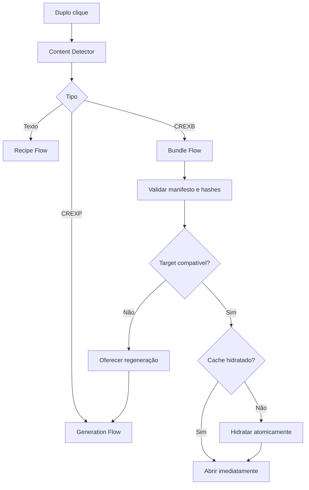

# CREXB — Creative Executable Bundle
## Handoff técnico, de produto e de arquitetura

**Projeto:** CREXE — Creative Executable  
**Componente proposto:** CREXB — Creative Executable Bundle  
**Extensão explícita recomendada:** `.crexb`  
**Formato físico:** ZIP controlado e manifestado  
**Documento consolidado em:** 25 de novembro de 2026  
**Status:** direção arquitetural proposta para implementação e RFC  
**Público:** mantenedores do CREXE, contribuidores, arquitetos, implementadores da engine, autores de resolvers, equipes de produto, segurança e revisão jurídica

---

## 1. Resumo executivo

O **CREXB — Creative Executable Bundle** é um novo formato do ecossistema CREXE destinado a representar, em um único arquivo:

1. a receita original;
2. a receita resolvida usada na geração;
3. o último build aceito e validado;
4. os metadados necessários para abrir o aplicativo sem chamar novamente um modelo de IA;
5. evidências de build, testes, target, toolchain e integridade;
6. informações suficientes para regenerar o software no futuro, quando necessário.

Fisicamente, um `.crexb` é um **ZIP controlado**, com estrutura, manifesto, hashes e regras obrigatórias. Ele não é apenas uma pasta compactada arbitrária.

A experiência de produto é:

```text
receita.crexe ou sistema.crexp
          ↓
CREXE gera, compila, testa e aceita uma versão
          ↓
Exportar bundle executável
          ↓
aplicativo.crexb
          ↓ duplo clique
CREXE identifica CREXB
          ↓
valida → hidrata no cache → abre o aplicativo
```

Na abertura de um CREXB compatível e íntegro:

- não há nova geração;
- não há chamada de IA;
- não há recompilação;
- não há necessidade de interpretar novamente todo o SDD;
- o payload compilado é copiado ou reutilizado no cache do CREXE;
- o aplicativo é aberto imediatamente;
- a receita permanece disponível para inspeção, atualização ou regeneração futura.

O CREXB é, portanto, um **snapshot executável e regenerável**.

---

## 2. Nome recomendado

### 2.1 CREXB

Nome recomendado:

```text
CREXB — Creative Executable Bundle
```

Extensão:

```text
.crexb
```

O nome comunica que o arquivo é um bundle controlado contendo mais do que uma receita.

### 2.2 Relação entre as extensões

| Extensão | Papel principal | Contém build compilado? | Precisa gerar ao abrir? |
|---|---|---:|---:|
| `.crexe` | Receita universal; texto ou envelope detectado por conteúdo | Opcional, se usado como alias universal | Depende do conteúdo |
| `.crexp` | Creative Executable Package; pacote SDD | Não por definição | Sim |
| `.crexb` | Creative Executable Bundle; receita + build aceito | Sim | Não, quando compatível |

### 2.3 `.crexe` como extensão universal

O CREXE poderá continuar aceitando um CREXB renomeado para `.crexe`.

Nesse cenário:

```text
aplicativo.crexe
```

pode conter:

- texto simples;
- YAML ou Markdown;
- CREXP ZIP;
- CREXB ZIP.

A engine identifica o tipo pelo conteúdo.

A extensão `.crexb` continua útil porque declara explicitamente:

> Este arquivo contém uma versão executável já gerada.

---

## 3. Problema que o CREXB resolve

O CREXP preserva especificações e intenção. Entretanto, abrir um CREXP normalmente exige:

1. interpretar documentos;
2. montar uma receita resolvida;
3. selecionar resolver;
4. selecionar agente;
5. gerar código;
6. instalar ou resolver dependências;
7. compilar;
8. testar;
9. corrigir eventuais erros;
10. abrir a aplicação.

Esse processo é valioso para portabilidade e evolução, mas pode ser caro, demorado, variável ou depender de rede e créditos de IA.

Há situações em que o usuário deseja apenas:

```text
baixar → dar dois cliques → abrir
```

Exemplos:

- um professor distribuindo um aplicativo para a turma;
- uma equipe compartilhando uma ferramenta interna;
- um autor vendendo um programa na Gallery;
- um usuário transferindo um aplicativo CREXE para outra máquina compatível;
- uma pessoa arquivando a versão funcional mais recente;
- um mantenedor preservando receita e binário no mesmo artefato;
- um usuário abrindo novamente um programa sem pagar outra geração.

O CREXB transforma o resultado do CREXE em um artefato distribuível e imediatamente executável, sem perder a receita que lhe deu origem.

---

## 4. Frase central

> **O CREXP contém o software em potencial. O CREXB contém o software já realizado, sem perder sua receita.**

Outra formulação:

> **Abra agora. Regenere no futuro.**

---

## 5. Decisões fundamentais

### 5.1 O CREXB é ZIP controlado

**Decisão proposta.**

Um CREXB deve possuir:

- manifesto obrigatório;
- layout definido;
- payload compilado;
- receita original;
- hashes obrigatórios;
- target explícito;
- entrypoint explícito;
- estado de validação explícito;
- regras estritas de extração.

Não se deve classificar como CREXB qualquer ZIP que apenas contenha um `.exe` e um prompt.

### 5.2 Empacotar o último build aceito, não a última tentativa

**Decisão recomendada.**

A engine deve exportar:

```text
last accepted generation
```

em vez de:

```text
last generation attempt
```

Um build só pode entrar no CREXB se satisfizer a política de aceite declarada.

Exemplo:

```text
source generated       ✓
build passed           ✓
tests passed           ✓
application started    ✓
acceptance passed      ✓ ou conforme política
```

Se a última tentativa falhou, a engine deve:

- exportar a última versão aceita, deixando isso explícito; ou
- recusar a exportação; ou
- permitir um bundle de diagnóstico não executável com outro tipo, nunca fingindo que é um CREXB válido.

### 5.3 Abrir sem regenerar

**Decisão central.**

Quando houver payload compatível e íntegro:

- não chamar IA;
- não executar o Recipe Compiler novamente para abrir;
- não recompilar;
- não instalar dependências sem necessidade;
- hidratar ou reutilizar o cache;
- iniciar o entrypoint.

### 5.4 A receita continua sendo preservada

**Decisão central.**

O bundle deve conter a receita original exata.

Pode conter também:

- receita resolvida;
- plano de geração;
- manifesto dos artefatos;
- source code;
- testes;
- logs selecionados.

### 5.5 O payload é target-specific

**Decisão central.**

A receita pode ser agnóstica. O build não é.

Exemplo:

```text
receita: portátil
payload: windows-x64
```

A primeira versão do CREXB deve priorizar **um target por bundle**.

Bundles multi-target podem ser adicionados posteriormente.

### 5.6 A engine hidrata em cache

**Decisão central.**

Ao abrir, a engine deve colocar o conteúdo executável em uma estrutura gerenciada sob AppData/cache.

O termo recomendado é:

```text
hydrate / hidratar
```

Embora a experiência possa ser descrita como “montar”, a implementação inicial deve extrair atomicamente para um diretório real. Muitos executáveis, DLLs, runtimes e loaders precisam de caminhos físicos.

Montagem virtual por FUSE, ProjFS ou tecnologia equivalente pode ser futura.

### 5.7 Cache é imutável; dados do usuário são separados

**Decisão central.**

O payload hidratado deve ser tratado como conteúdo imutável.

Dados mutáveis do aplicativo devem ficar em outro diretório.

Isso permite:

- atualizar o bundle sem perder dados;
- validar integridade;
- compartilhar conteúdo entre execuções;
- executar garbage collection;
- manter múltiplas versões lado a lado.

---

## 6. Relação conceitual entre CREXP e CREXB

### 6.1 CREXP

```text
intenção + especificações + recursos
```

Características:

- altamente portátil;
- independente do build atual;
- pode gerar para targets futuros;
- normalmente requer IA e toolchain ao abrir;
- pode produzir resultados diferentes em gerações futuras.

### 6.2 CREXB

```text
intenção + snapshot gerado + evidências
```

Características:

- abre imediatamente em target compatível;
- preserva resultado validado;
- reduz custo e latência;
- pode operar offline;
- continua regenerável porque preserva a receita;
- é maior e mais específico de plataforma.

### 6.3 Fluxo combinado

```text
CREXP
  ↓ gerar
cache de geração aceita
  ↓ exportar
CREXB
  ↓ abrir
cache hidratado
  ↓ executar
aplicativo
```

---

## 7. Estrutura física recomendada

### 7.1 Estrutura de referência

```text
aplicativo.crexb
└── ZIP
    ├── META-INF/
    │   ├── crexe-bundle.json
    │   ├── checksums.sha256
    │   ├── artifact-manifest.json
    │   ├── sbom.spdx.json                 opcional
    │   ├── third-party-notices.txt        opcional
    │   └── signatures/
    │       └── bundle.sig                 opcional
    │
    ├── recipe/
    │   ├── original.crexe                 ou original.crexp
    │   ├── resolved.yaml
    │   ├── generation-plan.json
    │   └── package-inventory.json         se aplicável
    │
    ├── payload/
    │   └── windows-x64/
    │       ├── app/
    │       │   ├── Example.exe
    │       │   ├── Example.dll
    │       │   └── ...
    │       ├── launch.json
    │       └── runtime-manifest.json
    │
    ├── source/                             opcional
    │   └── ...
    │
    ├── tests/                              opcional
    │   ├── results.json
    │   └── reports/
    │
    ├── evidence/
    │   ├── build.json
    │   ├── startup.json
    │   └── acceptance.json
    │
    └── docs/                               opcional
        └── README.md
```

### 7.2 Manifesto obrigatório

Caminho fixo:

```text
META-INF/crexe-bundle.json
```

Regras recomendadas:

- primeira entrada do ZIP;
- armazenada sem compressão;
- UTF-8;
- JSON estrito;
- tamanho limitado;
- não criptografada;
- `format` obrigatório;
- `schemaVersion` obrigatório.

### 7.3 Exclusividade do marcador

Um CREXB deve conter:

```json
{
  "format": "crexe.bundle"
}
```

Um CREXP não deve conter esse manifesto na raiz controlada.

Se o ZIP tiver simultaneamente:

- `META-INF/crexe-bundle.json`; e
- um manifesto CREXP de raiz conflitante;

sem que o CREXP esteja encapsulado sob `recipe/`, o pacote deve ser rejeitado como ambíguo.

---

## 8. Manifesto `crexe-bundle.json`

### 8.1 Exemplo

```json
{
  "format": "crexe.bundle",
  "schemaVersion": 1,
  "bundle": {
    "id": "org.example.bhaskara",
    "name": "Bhaskara",
    "version": "1.0.0",
    "buildId": "sha256:4d4d...",
    "createdAt": "2026-11-25T12:00:00Z",
    "kind": "executable-snapshot"
  },
  "publisher": {
    "name": "Example Publisher",
    "id": "org.example",
    "signatureRequired": false
  },
  "recipe": {
    "kind": "crexe-text",
    "path": "recipe/original.crexe",
    "sha256": "...",
    "resolvedPath": "recipe/resolved.yaml",
    "generationPlanPath": "recipe/generation-plan.json"
  },
  "generation": {
    "generationId": "gen_01...",
    "engineVersion": "2.0.0",
    "recipeCompilerVersion": "1.0.0",
    "resolver": {
      "id": "windows-desktop-dotnet",
      "version": "1.4.0"
    },
    "provider": {
      "id": "openai-responses",
      "model": "recorded-or-redacted"
    },
    "toolchainFingerprint": "sha256:..."
  },
  "targets": [
    {
      "id": "windows-x64",
      "os": "windows",
      "architecture": "x86_64",
      "abi": "windows",
      "payloadRoot": "payload/windows-x64/app/",
      "launchManifest": "payload/windows-x64/launch.json",
      "runtimeManifest": "payload/windows-x64/runtime-manifest.json",
      "runtimeModel": "self-contained"
    }
  ],
  "validation": {
    "status": "accepted",
    "acceptedAt": "2026-11-25T12:00:00Z",
    "build": "passed",
    "tests": "passed",
    "applicationStart": "passed",
    "acceptance": "passed"
  },
  "integrity": {
    "algorithm": "sha256",
    "checksumsPath": "META-INF/checksums.sha256",
    "artifactManifestPath": "META-INF/artifact-manifest.json"
  },
  "cache": {
    "contentKey": "sha256:...",
    "recipeKey": "sha256:..."
  },
  "behavior": {
    "allowRegeneration": true,
    "onIncompatibleTarget": "ask-to-regenerate",
    "onMissingRuntime": "ask-to-repair",
    "onIntegrityFailure": "block"
  }
}
```

### 8.2 Campos essenciais

| Campo | Objetivo |
|---|---|
| `format` | Identificar o ZIP como CREXB |
| `schemaVersion` | Versionar o contrato |
| `bundle.id` | Identidade estável do aplicativo |
| `bundle.version` | Versão funcional/comercial |
| `bundle.buildId` | Identidade imutável do build |
| `recipe` | Localizar e validar a receita |
| `generation` | Registrar origem da geração |
| `targets` | Determinar compatibilidade |
| `validation.status` | Impedir exportação de build não aceito |
| `integrity` | Validar conteúdo |
| `behavior` | Definir fallback e regeneração |

---

## 9. Receita dentro do bundle

### 9.1 Receita simples

Se a origem for `.crexe` textual:

```text
recipe/original.crexe
```

O arquivo deve ser preservado byte a byte.

### 9.2 Origem CREXP

Se a origem for um CREXP:

```text
recipe/original.crexp
```

O CREXP original pode ser armazenado como ZIP aninhado, preservando:

- bytes;
- assinatura;
- estrutura;
- hashes;
- documentação.

A engine também pode incluir:

```text
recipe/package-inventory.json
recipe/resolved.yaml
```

### 9.3 Não expandir o CREXP na raiz

O conteúdo original deve ficar encapsulado sob `recipe/` para não confundir o detector de formato.

### 9.4 Receita resolvida

```text
recipe/resolved.yaml
```

Contém a visão normalizada usada na geração.

Ela não substitui a receita original.

---

## 10. Payload compilado

### 10.1 Payload mínimo

Um target precisa conter:

```text
payload/<target>/app/
payload/<target>/launch.json
payload/<target>/runtime-manifest.json
```

### 10.2 `launch.json`

Exemplo:

```json
{
  "entrypoint": "app/Bhaskara.exe",
  "workingDirectory": "app/",
  "arguments": [],
  "environment": {
    "CREXE_PACKAGE_ID": "org.example.bhaskara"
  },
  "windowMode": "normal",
  "singleInstance": false
}
```

### 10.3 Runtime

Exemplo self-contained:

```json
{
  "model": "self-contained",
  "dependencies": [],
  "requiresInstallation": false
}
```

Exemplo framework-dependent:

```json
{
  "model": "framework-dependent",
  "dependencies": [
    {
      "name": ".NET Runtime",
      "version": "10.0",
      "required": true
    }
  ],
  "requiresInstallation": true
}
```

### 10.4 Preferência por payload autossuficiente

Para a melhor experiência de dois cliques, o exportador deve favorecer:

```text
self-contained / portable payload
```

quando:

- tecnicamente viável;
- juridicamente permitido;
- tamanho aceitável;
- licença das dependências permitir redistribuição.

---

## 11. Single-target e multi-target

### 11.1 V1 do formato

Recomendação:

```text
um CREXB = um target principal
```

Exemplos:

```text
app-windows-x64.crexb
app-linux-x64.crexb
app-macos-arm64.crexb
```

### 11.2 Multi-target futuro

Um bundle futuro pode conter:

```text
payload/windows-x64/
payload/linux-x64/
payload/macos-arm64/
```

A engine escolhe o melhor target.

### 11.3 Não esconder incompatibilidade

Um CREXB Windows não deve fingir ser executável no Linux.

Como contém a receita, a engine pode oferecer:

```text
Este bundle não possui payload para linux-x64.
Deseja gerar uma versão compatível a partir da receita incluída?
```

Nunca regenerar silenciosamente se isso consumir IA, rede ou recursos significativos, salvo política explícita.

---

## 12. Opção de exportação na engine

### 12.1 Ação de produto

Após geração aceita:

```text
Exportar bundle executável
```

Opções:

```text
Target atual
Incluir código-fonte
Incluir testes
Incluir logs
Incluir SBOM
Assinar bundle
Formato explícito .crexb
Formato universal .crexe
```

### 12.2 CLI proposta

```bash
crexe bundle create app.crexe \
  --target current \
  --output app.crexb
```

A partir do cache:

```bash
crexe bundle create \
  --generation gen_01H... \
  --output app.crexb
```

Com source:

```bash
crexe bundle create app.crexp \
  --target windows-x64 \
  --include-source \
  --include-tests \
  --output app-windows-x64.crexb
```

### 12.3 Política de seleção do build

```text
--generation latest-accepted
```

como default.

Outras opções:

```text
--generation <id>
--generation current
```

`current` só pode ser usado se o estado atual estiver aceito.

---

## 13. Algoritmo de criação do CREXB

```text
1. localizar geração aceita;
2. bloquear alterações concorrentes;
3. validar artifact manifest;
4. validar entrypoint;
5. validar target;
6. copiar receita original;
7. copiar receita resolvida;
8. copiar payload compilado;
9. copiar evidências selecionadas;
10. gerar SBOM e notices, se habilitado;
11. gerar checksums;
12. montar manifesto;
13. opcionalmente assinar;
14. criar ZIP determinístico;
15. validar o ZIP recém-criado;
16. escrever arquivo final atomicamente.
```

### 13.1 ZIP determinístico

Recomendação:

- ordem canônica de entradas;
- paths UTF-8;
- timestamps normalizados em modo reproducible;
- sem entradas duplicadas;
- `META-INF/crexe-bundle.json` primeiro;
- métodos `store` ou `deflate` inicialmente;
- sem encryption;
- sem symlink;
- sem hardlink;
- sem path traversal;
- ZIP64 somente quando necessário.

---

## 14. Detecção de tipo

### 14.1 Problema

CREXP e CREXB são ZIPs.

A engine precisa diferenciá-los sem extrair e executar conteúdo arbitrário.

### 14.2 Ordem de detecção

```text
1. ler extensão como hint;
2. confirmar ZIP estruturalmente;
3. ler Central Directory;
4. procurar META-INF/crexe-bundle.json;
5. se presente e válido → CREXB;
6. senão procurar crexp.yaml ou inferir SDD → CREXP;
7. senão → ZIP desconhecido.
```

### 14.3 Matriz

| Marcador | Resultado |
|---|---|
| `META-INF/crexe-bundle.json` válido | CREXB |
| `crexp.yaml` ou SDD inferível, sem bundle manifest | CREXP |
| Ambos em posições conflitantes | Rejeitar como ambíguo |
| Nenhum | ZIP genérico/desconhecido |

### 14.4 `.crexe` polimórfico

```text
.crexe + texto       → Recipe Mode
.crexe + CREXP ZIP   → Package Mode
.crexe + CREXB ZIP   → Bundle Mode
```

---

## 15. Fluxo de duplo clique



### 15.1 Garantia de abertura rápida

Em target compatível:

```text
validate → hydrate/cache hit → launch
```

Não entrar no fluxo de IA.

---

## 16. Hidratação no cache

### 16.1 Por que não executar diretamente do ZIP

- loaders precisam de arquivos reais;
- DLLs e assets usam caminhos relativos;
- executáveis compactados não podem ser iniciados diretamente por todos os sistemas;
- permissões precisam ser aplicadas;
- antivírus e assinatura operam melhor em arquivos materializados;
- diretório de trabalho precisa ser estável.

### 16.2 Hidratação atômica

```text
1. calcular hash do bundle;
2. adquirir lock;
3. verificar cache existente;
4. criar staging directory;
5. extrair com segurança;
6. validar cada hash;
7. validar target e entrypoint;
8. aplicar permissões;
9. escrever marker .complete;
10. rename atômico para diretório final;
11. atualizar índice;
12. liberar lock;
13. executar.
```

### 16.3 Nunca considerar staging como válido

Somente um diretório contendo:

```text
.complete
```

após verificação deve ser utilizado.

---

## 17. Estrutura de cache e AppData

### 17.1 Modelo abstrato

```text
CacheRoot/
├── objects/
│   └── sha256/
│       └── ab/
│           └── abcdef.../
│               ├── META-INF/
│               ├── recipe/
│               ├── payload/
│               ├── evidence/
│               ├── bundle.source.json
│               └── .complete
│
├── packages/
│   └── org.example.bhaskara/
│       ├── versions/
│       │   └── 1.0.0/
│       │       └── windows-x64.json
│       └── current.json
│
└── locks/
```

### 17.2 Dados mutáveis

```text
DataRoot/
└── packages/
    └── org.example.bhaskara/
        ├── data/
        ├── config/
        └── documents/
```

### 17.3 Estado e logs

```text
StateRoot/
└── packages/
    └── org.example.bhaskara/
        ├── state.json
        ├── launches.jsonl
        └── logs/
```

### 17.4 Windows

```text
%LOCALAPPDATA%\CREXE\Cache
%LOCALAPPDATA%\CREXE\Apps
%LOCALAPPDATA%\CREXE\State
```

### 17.5 Linux

```text
$XDG_CACHE_HOME/crexe
$XDG_DATA_HOME/crexe
$XDG_STATE_HOME/crexe
```

Fallbacks devem seguir convenções da plataforma.

### 17.6 macOS

```text
~/Library/Caches/CREXE
~/Library/Application Support/CREXE
~/Library/Application Support/CREXE/State
```

---

## 18. Separação entre cache e dados do aplicativo

### 18.1 Cache imutável

O payload não deve gravar em sua própria pasta.

A engine pode torná-la read-only após hidratação.

### 18.2 Diretório de dados

O processo pode receber:

```text
CREXE_DATA_DIR
CREXE_CONFIG_DIR
CREXE_STATE_DIR
CREXE_CACHE_DIR
CREXE_PACKAGE_ID
CREXE_BUNDLE_ID
```

Aplicações geradas pelo CREXE podem ser instruídas a respeitar essas variáveis.

### 18.3 Aplicações que usam convenções nativas

Um aplicativo pode continuar usando:

- AppData;
- XDG;
- Library/Application Support;
- banco externo;
- diretório escolhido pelo usuário.

O manifesto deve registrar se o app é:

```text
crexe-managed-data
native-managed-data
external-data
```

---

## 19. Cache hit

### 19.1 Identidade

O cache deve ser endereçado por conteúdo.

```text
bundle raw SHA-256
```

ou por um hash canônico declarado e validado.

### 19.2 Cache hit válido

Só reutilizar se:

- diretório final existe;
- `.complete` existe;
- manifesto coincide;
- hashes essenciais coincidem;
- target continua compatível;
- política não exige revalidação;
- entrypoint existe.

### 19.3 Benefício

Na segunda abertura:

```text
hash → lookup → launch
```

Sem nova extração.

---

## 20. Target e compatibilidade

### 20.1 Fingerprint de host

```text
os
architecture
abi
runtime availability
cpu features relevantes
sandbox policy
```

### 20.2 Compatibilidade exata

Exemplo:

```text
bundle: windows-x64
host: windows-x64
```

### 20.3 Compatibilidade ampliada

Pode haver regras:

```text
windows-x64 em Windows ARM64 com emulação
linux-x64 em distribuição compatível
.NET framework-dependent com runtime correto
```

Essas regras pertencem ao resolver/runtime compatibility layer.

### 20.4 Sem target compatível

A engine mostra:

```text
O bundle contém uma versão para windows-x64.
Este computador é linux-x64.
A receita original está incluída e pode ser regenerada.
```

Opções:

```text
Gerar para este computador
Inspecionar receita
Cancelar
```

---

## 21. Fluxo normal após a abertura

O usuário afirmou que, depois de abrir, “segue o fluxo normal”. Esse fluxo deve ser explicitado.

### 21.1 Ações disponíveis

```text
Abrir aplicativo
Inspecionar receita
Ver código-fonte
Ver relatório de geração
Regenerar
Gerar para outro target
Exportar novo CREXB
Atualizar versão
Remover do cache
Remover dados
```

### 21.2 Relação com a origem

O estado local deve lembrar:

```text
package id
bundle id
recipe hash
generation id
current target
cache object
source file path, quando disponível
```

### 21.3 Regeneração

Regenerar cria uma nova geração e não altera o bundle original.

Depois de aceita:

```text
Exportar nova versão
```

produz outro CREXB.

---

## 22. Atualização e versões

### 22.1 Identidades diferentes

```text
package.id     identidade lógica
version        versão do produto
buildId        snapshot imutável
bundle hash    bytes exatos do arquivo
```

### 22.2 Múltiplas versões em cache

```text
1.0.0 build A
1.0.0 build B
1.1.0 build C
```

podem coexistir.

### 22.3 Current pointer

```text
current.json
```

aponta para o build selecionado.

Não usar symlink como único mecanismo cross-platform.

### 22.4 Rollback

A engine pode permitir:

```text
Voltar para a versão anterior
```

sem perder dados compatíveis.

Migrações de dados devem ser declaradas separadamente.

---

## 23. Segurança

### 23.1 CREXB contém executável

Ele deve ser tratado como software potencialmente perigoso.

A existência da receita não prova segurança.

### 23.2 Ordem de confiança

```text
1. integridade estrutural;
2. hashes;
3. assinatura do bundle;
4. identidade do publisher;
5. assinatura do executável, se houver;
6. política local;
7. sandbox/reputação;
8. decisão do usuário.
```

### 23.3 Unsigned bundle

Pode ser permitido para desenvolvimento local, mas deve ser identificado:

```text
Publisher não verificado
```

### 23.4 Gallery

Para distribuição pública, recomendar:

- assinatura;
- scanning;
- SBOM;
- publisher verificado;
- policy review;
- malware scanning;
- provenance.

### 23.5 Extração segura

Aplicar as mesmas proteções do CREXP:

- ZIP Slip;
- ZIP bomb;
- symlink;
- paths absolutos;
- nomes duplicados;
- case collisions;
- Unicode ambiguity;
- encrypted entries;
- compression ratio;
- tamanho máximo;
- executáveis fora de payload;
- entrypoint apontando para fora.

### 23.6 Nenhum código antes da verificação

Não carregar DLL, plugin, ícone com parser inseguro ou executável antes de concluir validação básica.

---

## 24. Integridade

### 24.1 Checksums

```text
META-INF/checksums.sha256
```

Formato sugerido:

```text
<sha256>  recipe/original.crexe
<sha256>  payload/windows-x64/app/Bhaskara.exe
```

### 24.2 Artifact manifest

```json
{
  "artifacts": [
    {
      "path": "payload/windows-x64/app/Bhaskara.exe",
      "role": "entrypoint",
      "size": 123456,
      "sha256": "..."
    }
  ]
}
```

### 24.3 Assinatura

Uma assinatura deve cobrir, no mínimo:

- manifesto;
- checksums;
- identidade do publisher;
- versão do schema.

A escolha de formato criptográfico deve ser definida em RFC própria.

---

## 25. Código-fonte no bundle

### 25.1 Opcional no formato

Um CREXB pode incluir:

```text
source/
```

### 25.2 Obrigação por licença

Se o payload incorporar software cuja licença exige fornecimento de fonte correspondente, o exportador precisa cumprir essa obrigação.

### 25.3 Relação com o CREXE GPL

O aplicativo gerado não se torna GPL apenas por ter sido gerado pelo CREXE.

O bundle deve registrar:

- licença da receita;
- licença do código gerado;
- licenças das dependências;
- notices;
- source offer, se aplicável.

---

## 26. Privacidade

### 26.1 Receita pode conter informações sensíveis

Antes de exportar, a engine deve oferecer scanner para:

- secrets;
- tokens;
- passwords;
- connection strings;
- dados pessoais;
- caminhos locais;
- logs sensíveis;
- prompts internos que não deveriam ser distribuídos.

### 26.2 Modos de exportação

```text
complete
redacted
binary-only-with-recipe-summary
internal
public
```

O modelo principal deste documento exige receita. Entretanto, a política pode permitir receita redigida ou encapsulada criptograficamente em produtos específicos, desde que isso seja outro perfil claramente identificado.

---

## 27. Recipe-to-build linkage

O CREXB precisa provar que o payload corresponde à receita incluída.

Registrar:

```text
recipe hash
resolved recipe hash
generation plan hash
source tree hash
payload hash
validation evidence hash
```

Isso não prova correção semântica absoluta, mas cria cadeia de proveniência.

---

## 28. Pseudocódigo de detecção

```rust
fn detect_creative_content(path: &Path) -> Result<CreativeContentKind> {
    if !looks_like_zip(path)? {
        if is_valid_utf8_recipe(path)? {
            return Ok(CreativeContentKind::Recipe);
        }

        return Err(CrexeError::UnsupportedInput);
    }

    let zip = open_validated_zip_directory(path)?;

    let has_bundle_manifest =
        zip.contains("META-INF/crexe-bundle.json");

    let has_root_crexp_manifest =
        zip.contains("crexp.yaml") || zip.contains("crexp.yml");

    if has_bundle_manifest && has_root_crexp_manifest {
        return Err(CrexeError::AmbiguousCreativeZip);
    }

    if has_bundle_manifest {
        let manifest = read_bundle_manifest(&zip)?;

        if manifest.format != "crexe.bundle" {
            return Err(CrexeError::InvalidBundleManifest);
        }

        return Ok(CreativeContentKind::ExecutableBundle);
    }

    if has_root_crexp_manifest || looks_like_sdd_package(&zip)? {
        return Ok(CreativeContentKind::SpecPackage);
    }

    Ok(CreativeContentKind::UnknownZip)
}
```

---

## 29. Pseudocódigo de abertura

```rust
fn open_crexb(
    path: &Path,
    context: &OpenContext,
) -> Result<LaunchResult> {
    let raw_hash = sha256_file(path)?;
    let zip = validate_crexb(path, &context.package_limits)?;
    let manifest = parse_bundle_manifest(&zip)?;

    verify_bundle_structure(&zip, &manifest)?;
    verify_checksums(&zip, &manifest)?;
    verify_signature_if_required(&zip, &manifest, &context.trust)?;

    let host = HostFingerprint::detect()?;
    let target = select_compatible_target(&manifest.targets, &host);

    let Some(target) = target else {
        return offer_regeneration_from_embedded_recipe(
            path,
            &manifest,
            context,
        );
    };

    let object_path = context
        .cache
        .object_path_for_sha256(&raw_hash);

    let hydrated = if is_valid_hydrated_object(
        &object_path,
        &manifest,
        target,
    )? {
        object_path
    } else {
        hydrate_bundle_atomically(
            &zip,
            &manifest,
            target,
            &object_path,
            context,
        )?
    };

    register_package_version(
        &manifest,
        target,
        &raw_hash,
        &hydrated,
        context,
    )?;

    let launch = read_launch_manifest(&hydrated, target)?;
    let runtime_dirs = ensure_runtime_data_directories(
        &manifest.bundle.id,
        context,
    )?;

    launch_entrypoint(
        &hydrated,
        &launch,
        &runtime_dirs,
        context,
    )
}
```

---

## 30. Pseudocódigo de hidratação

```rust
fn hydrate_bundle_atomically(
    zip: &ValidatedZip,
    manifest: &BundleManifest,
    target: &Target,
    final_path: &Path,
    context: &OpenContext,
) -> Result<PathBuf> {
    let _lock = context.cache.lock(final_path)?;

    if is_valid_hydrated_object(final_path, manifest, target)? {
        return Ok(final_path.to_path_buf());
    }

    let staging = context.cache.create_staging_dir()?;

    secure_extract_selected_entries(
        zip,
        &staging,
        entries_required_for_target(manifest, target),
    )?;

    verify_extracted_hashes(&staging, manifest)?;
    verify_entrypoint(&staging, target)?;
    apply_platform_permissions(&staging, target)?;
    write_source_metadata(&staging, manifest, context)?;
    write_complete_marker(&staging)?;

    atomic_promote(staging, final_path)?;

    Ok(final_path.to_path_buf())
}
```

---

## 31. Estados

```text
Detected
ManifestRead
StructurallyValidated
IntegrityValidated
SignatureValidated
TargetSelected
CacheHit
Hydrating
Hydrated
Registered
Launching
Running
Exited
Incompatible
RepairRequired
RegenerationOffered
Failed
Blocked
```

---

## 32. CLI proposta

```bash
crexe bundle inspect app.crexb
crexe bundle verify app.crexb
crexe bundle hydrate app.crexb
crexe bundle run app.crexb
crexe bundle create app.crexp --output app.crexb
crexe bundle create --generation <id> --output app.crexb
crexe bundle list-cache
crexe bundle remove-cache <bundle-id>
crexe bundle regenerate app.crexb --target linux-x64
```

Com extensão universal:

```bash
crexe inspect app.crexe
```

Saída:

```text
Detected ZIP: yes
Creative kind: CREXB executable bundle
Package: org.example.bhaskara
Version: 1.0.0
Payload: windows-x64
Validation: accepted
Cache: hydrated
Regeneration: available
```

---

## 33. API e interfaces propostas

```rust
enum CreativeContentKind {
    Recipe,
    SpecPackage,
    ExecutableBundle,
    UnknownZip,
}
```

```rust
trait BundleExporter {
    fn export(
        &self,
        generation: &AcceptedGeneration,
        options: &BundleExportOptions,
        output: &Path,
    ) -> Result<BundleExportResult>;
}
```

```rust
trait BundleHydrator {
    fn hydrate(
        &self,
        bundle: &ValidatedBundle,
        target: &Target,
        cache: &CacheLayout,
    ) -> Result<HydratedBundle>;
}
```

```rust
trait TargetCompatibility {
    fn score(
        &self,
        target: &BundleTarget,
        host: &HostFingerprint,
    ) -> CompatibilityScore;
}
```

---

## 34. Políticas de abertura

### 34.1 Integridade falhou

```text
Bloquear.
```

Nunca regenerar silenciosamente a partir de um bundle adulterado.

O usuário pode extrair a receita somente em modo seguro, se permitido.

### 34.2 Assinatura desconhecida

```text
Avisar e pedir decisão conforme política.
```

### 34.3 Runtime ausente

Opções:

```text
Instalar runtime
Regenerar self-contained
Cancelar
```

### 34.4 Entry point ausente

```text
Bundle inválido ou cache corrompido.
Rehidratar.
```

Se persistir:

```text
Oferecer regeneração.
```

### 34.5 Payload incompatível

```text
Não executar.
Oferecer regeneração para o host.
```

---

## 35. Garbage collection

### 35.1 Objetivos

- remover versões não usadas;
- preservar current;
- preservar versões pinadas;
- não remover dados do usuário;
- respeitar bundles em execução;
- liberar espaço.

### 35.2 Políticas

```text
LRU
idade máxima
limite total
pin manual
manter N versões
```

### 35.3 Separação crítica

```text
remover cache != remover dados
```

A interface deve deixar isso claro.

---

## 36. Concorrência

Dois duplos cliques simultâneos não devem:

- extrair duas vezes;
- corromper cache;
- atualizar `current.json` de forma parcial;
- executar payload incompleto.

Usar:

- lock por bundle hash;
- staging único;
- promoção atômica;
- índice transacional ou arquivos atomicamente substituídos.

---

## 37. Gallery

### 37.1 Tipos de distribuição

A Gallery pode oferecer:

```text
CREXP — gerar para seu ambiente
CREXB — abrir imediatamente no target informado
ambos — download instantâneo + capacidade de regenerar
```

### 37.2 Produto pago

O CREXB pode reduzir:

- custo de geração;
- chamadas de IA;
- suporte por toolchain;
- tempo até primeiro uso.

### 37.3 Receita incluída

Como a receita está no bundle, o modelo comercial precisa depender de licença e termos, não de obscuridade.

A Gallery pode administrar:

- licença por usuário;
- updates;
- assinatura;
- reputação;
- verificação;
- conformidade;
- reembolso;
- suporte.

---

## 38. Educação

O CREXB é especialmente útil para laboratórios escolares.

Fluxo:

```text
professor gera aplicativo
        ↓
exporta CREXB para Windows do laboratório
        ↓
distribui por rede ou pendrive
        ↓
alunos dão dois cliques
        ↓
abertura sem IA e sem compilador
```

Benefícios:

- custo de geração pago uma vez;
- funcionamento offline;
- resultado idêntico para a turma;
- receita disponível para modo aprendizagem;
- código-fonte opcional lado a lado;
- atualização controlada.

---

## 39. Ferramentas internas

Aplicativos como:

- MdDesk;
- JiraImporter;
- SmtpEmailTesterDotNet8;
- IdentityAdminTool;
- EmlDesk;
- AzureAwsLatencyTester;

podem ser exportados como CREXB para:

- abrir imediatamente em outras máquinas compatíveis;
- preservar a receita;
- evitar nova geração;
- manter evidência da versão aceita;
- permitir regeneração futura.

---

## 40. Preservação histórica

Um CREXB pode arquivar:

```text
receita
source
binário
resolver
build evidence
toolchain fingerprint
screenshots
testes
```

Isso cria um artefato mais completo que um executável isolado.

Entretanto, builds para plataformas históricas podem depender de:

- sistemas operacionais protegidos;
- ROMs;
- SDKs proprietários;
- bibliotecas não redistribuíveis.

O exportador precisa respeitar essas restrições.

---

## 41. Não objetivos da V1

A primeira versão do CREXB não precisa:

- ser um container universal como Docker;
- virtualizar sistema operacional;
- incluir qualquer runtime automaticamente;
- suportar delta updates;
- suportar streaming execution;
- montar ZIP como filesystem virtual;
- conter múltiplos targets;
- garantir reprodução bit a bit em outro toolchain;
- substituir instaladores do sistema;
- contornar assinatura de código da plataforma.

---

## 42. Critérios de aceite

### 42.1 Exportação

- exporta a última geração aceita;
- inclui receita original;
- inclui manifesto válido;
- inclui payload;
- inclui launch manifest;
- inclui hashes;
- produz ZIP válido;
- valida o próprio output.

### 42.2 Detecção

- distingue CREXB de CREXP;
- distingue ambos de ZIP genérico;
- funciona com `.crexb`;
- funciona com `.crexe` universal;
- rejeita pacote ambíguo.

### 42.3 Hidratação

- usa staging;
- bloqueia traversal;
- valida hashes;
- promove atomicamente;
- escreve `.complete`;
- reaproveita cache na segunda abertura.

### 42.4 Execução

- não chama IA em cache hit compatível;
- não recompila;
- abre entrypoint;
- usa diretório de trabalho correto;
- fornece diretórios de dados;
- registra launch.

### 42.5 Incompatibilidade

- não executa binário incompatível;
- oferece regeneração;
- preserva receita;
- deixa claro que haverá custo/processamento.

### 42.6 Integridade

- alteração de payload é detectada;
- alteração de manifesto é detectada;
- cache corrompido é reidratado;
- assinatura obrigatória inválida bloqueia.

---

## 43. Roadmap sugerido

### Fase 1 — Bundle local mínimo

- `.crexb`;
- manifesto;
- single-target;
- receita textual;
- payload;
- checksums;
- exportação da última geração aceita;
- hidratação em cache;
- abertura sem regenerar.

### Fase 2 — CREXP dentro do CREXB

- `original.crexp`;
- recipe resolved;
- generation plan;
- source opcional;
- tests/evidence;
- fallback para regeneração.

### Fase 3 — confiança

- assinatura;
- publisher;
- Gallery;
- SBOM;
- scanning;
- notices.

### Fase 4 — multi-target

- múltiplos payloads;
- seleção automática;
- fat bundles;
- download parcial futuro.

### Fase 5 — updates

- canais;
- delta;
- rollback;
- migrações;
- políticas corporativas.

---

## 44. Registro de decisões

| ID | Decisão | Estado |
|---|---|---|
| B-001 | Nome de referência CREXB | Proposta recomendada |
| B-002 | Extensão `.crexb` | Proposta recomendada |
| B-003 | Formato físico ZIP controlado | Confirmada conceitualmente |
| B-004 | Receita + último build aceito | Confirmada conceitualmente |
| B-005 | Abrir sem regenerar quando compatível | Confirmada |
| B-006 | Manifesto obrigatório em `META-INF` | Recomendada |
| B-007 | Diferenciar CREXB de CREXP pelo manifesto | Recomendada |
| B-008 | Hidratar no AppData/cache | Confirmada |
| B-009 | Cache imutável e dados separados | Recomendada |
| B-010 | Single-target na V1 | Recomendada |
| B-011 | Regeneração como fallback explícito | Confirmada |
| B-012 | Receita original preservada byte a byte | Recomendada |
| B-013 | Última geração aceita, não última tentativa | Recomendada |
| B-014 | Verificação de hashes antes da execução | Recomendada |
| B-015 | Assinatura opcional local e recomendada pública | Recomendada |
| B-016 | `.crexe` pode servir como alias universal | Compatível com direção atual |

---

## 45. Comparação final

```text
CREXE textual
    intenção simples

CREXP
    intenção estruturada / SDD

CREXB
    intenção + implementação aceita
```

Em termos de produto:

```text
CREXE  → descreva
CREXP  → especifique
CREXB  → distribua e abra
```

---

## 46. Definição final

O CREXB é:

> Um ZIP controlado, verificável e target-specific que contém a receita original, a receita resolvida, o último build aceito, seu payload executável, metadados de lançamento, integridade e evidências de geração, permitindo que a CREXE Engine hidrate o conteúdo em seu cache e abra o aplicativo imediatamente, sem regeneração, preservando ao mesmo tempo a capacidade de inspeção, atualização e regeneração futura.

---

## 47. Frases de produto

> **Gerado uma vez. Aberto quantas vezes quiser.**

> **A receita e o aplicativo, juntos.**

> **Abra agora. Regenere no futuro.**

Em inglês:

> **Generated once. Opened whenever needed.**

> **Recipe and application, together.**

> **Run now. Regenerate later.**

---

## 48. Próximos passos imediatos

1. aprovar ou renomear `CREXB`;
2. criar RFC do manifesto v1;
3. criar JSON Schema;
4. implementar detector CREXB/CREXP;
5. implementar exportação de geração aceita;
6. implementar layout de cache;
7. implementar hidratação atômica;
8. implementar launch manifest;
9. adicionar fallback de regeneração;
10. criar primeiro bundle real com um aplicativo já validado do CREXE.

---

## 49. Observação jurídica e de distribuição

Este documento define arquitetura e produto. A distribuição de payloads precisa respeitar:

- licença da receita;
- licença do código gerado;
- licenças das dependências;
- redistribuição de runtimes;
- notices;
- marcas;
- assinatura de código;
- termos da Gallery;
- privacidade dos documentos incluídos.

A licença GPL do CREXE Core não torna automaticamente o payload gerado GPL. O bundle precisa registrar separadamente as licenças de cada camada.
